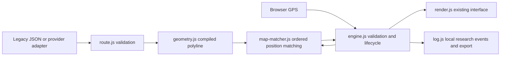

# Geometry-aware navigation architecture (Phase 2)

Based exactly on `cd5e77ec5d9d6bae5638051a8472132e6b741b9f` from
`Mithi-gh/augmentum--mithi-codex`, branch `development/navigation-foundation`.
Remote verification at the start of this work showed main still at `3db349d`.
The Phase 2 feature branch was created from the foundation SHA, not main.

## Boundaries



`route.js`, `geometry.js` and `map-matcher.js` run without a DOM, navigator, clock,
renderer or logging system. Browser classic scripts keep the application build
free; tests also load these modules into a bare JavaScript VM. No framework,
backend, map SDK or runtime npm dependency was added. Load `route.js`,
`geometry.js`, and `map-matcher.js` before `engine.js`; the renderer is called only
after initialization.

## Accepted wire formats

The original array of `{lat,lng,cue,seg,rot,land,distFromPrevious}` remains accepted
without modification. Distances are recalculated, never trusted. It compiles to a
polyline between waypoints and reports matched progress, but deliberately retains
foundation waypoint confirmation/corridor behavior for compatibility. It cannot
reconstruct curves that were never recorded. For geometry-based instruction and
arrival behavior, supply a version 2 document:

```json
{
  "schemaVersion": 2,
  "id": "route-123",
  "revision": "1",
  "geometry": [[-0.12,51.5],[-0.119,51.5],[-0.119,51.501]],
  "maneuvers": [
    {"geometryIndex":1,"cue":"turn","rot":-90,"seg":"unknown","instruction":"Turn left"},
    {"geometryIndex":2,"cue":"arrive","seg":"unknown"}
  ],
  "source": {"provider":"provider-name","profile":"cycling","attribution":"Required attribution"}
}
```

Coordinates use **[longitude, latitude]**, as in GeoJSON. `geometry` is an array of
2–100000 coordinates; adjacent edges must be 0.1m–10km long. Dense samples are
preferable at curves. Maneuvers (1–10000) reference increasing vertex indices
starting at 1; the final maneuver must reference the final coordinate. An arrive
cue cannot occur earlier. A start pseudo-maneuver is unnecessary. Rotations use
existing signed degrees; `seg` defaults to unknown, never inferred as surveyed.
`instruction` is optional text (escaped by the renderer); `exitNumber` supports
roundabouts (1–20). All distance metadata is derived, ignoring imported totals.
`id` and string `revision` identify the route in research logs. Unknown fields are
not forwarded. The browser import also enforces a 2MB file limit.

A future Mapbox, GraphHopper, openrouteservice or other adapter must decode the
provider's geometry into this format and map instructions to semantic cues and
geometry indices. Encoded polyline strings and raw provider responses are not
accepted directly. No routing API is contacted in this phase.

## Compiled geometry

`RouteGeometry.compile(input)` returns vertices, metre-based cumulative distances,
segments with distance ranges/bearings, maneuvers with distance along the route,
leg lengths, source and route identity. `length` sums the full polyline, not chords
between maneuvers. Projection uses a local plane per edge, haversine length and
wrapped longitude differences. The coordinate returned is on that edge.
`candidates(model, coordinate, minAlong, maxAlong)` uses binary search then scans
only overlapping segment ranges; projection is clipped to the reachable range.

The projection is an approximation for locally dense cycling geometry, not a
geodesic world-routing or altitude model. The 10km edge bound is a validation
limit, not a claim of field accuracy at that spacing or at polar latitudes.

## Matcher contract and choices

`new RouteMatcher(model)` owns only an ordered anchor and previous sensor evidence.
`update({lat,lng,t,accuracy,speed,heading}, {limit})` consumes metre/second and degree
values, with timestamps in milliseconds. The engine additionally checks freshness
against the wall clock. The matcher rejects out-of-order samples and implausible
displacement (>25m/s plus the uncertainty of both fixes). Its result contains:

- `status`: waiting, matched, stationary, ambiguous, unmatched, weak, reacquiring,
  lost, or invalid;
- `along`: accepted distance from route start, which can decrease during credible
  reverse travel;
- `segmentIndex`, snapped `coordinate`, local `crossTrack` distance and `usable`.

Important rules:

1. Acquisition requires proximity to the recorded start (within the lesser of 25m
   or half the first maneuver distance). A rider near a later loop is not globally
   snapped onto it. Before acquisition the engine waits, without claiming arrival
   or off-route.
2. Search is local to previous accepted progress. Continuous samples search
   backward at least 20m and forward 20–100m depending on observed displacement and
   accuracy. The engine also caps lookahead beyond the pending maneuver to the
   lesser of 30m or half the next leg. It cannot skip a whole series of maneuvers.
3. Candidate score considers cross-track distance, difference from predicted
   progress, travel bearing and segment continuity. Device heading is used only
   when speed >=1m/s; inferred heading requires displacement larger than reported
   accuracy (and at least 3m). Reverse movement on the current path is allowed;
   a future return leg is not treated as equivalent reverse travel.
4. Nearby nonadjacent candidates with different along-route positions and similar
   scores produce `ambiguous`. The anchor is retained. Stationary readings
   (speed <=0.5m/s) never ratchet accepted progress, even when GPS jitters forward.
5. Accuracy >=20m freezes matching/progression instead of widening search onto
   nearby streets. Thus 5m/10m are usable research inputs, while 20m/50m are tested
   degraded modes. Poor signals, errors and >5s gaps interrupt continuity.
6. Reacquisition searches only +/-30m around the old anchor and needs three local,
   topologically consistent reliable fixes. A distant rejoin remains lost instead
   of silently assuming route progress. The anchor is not extrapolated through an
   outage. Rejoining beyond this bound currently requires ending the session and
   returning to the start; broader recovery needs an explicit future user flow.

These are conservative heuristics with testable thresholds, not an HMM, lane
matcher or guarantee of correct road identity. Parallel streets inside GPS
uncertainty and grade-separated crossings can remain indistinguishable. Slowly
rolling with unavailable device speed may still be classified as stationary by
the foundation speed fallback. Very short loops/closely spaced maneuvers and
sparse high-speed traces may remain uncertain rather than progress. Raw GPS drift
that imitates plausible forward travel cannot always be detected.

## Engine integration and maneuvers

The engine retains GPS validation, watch generations, lifecycle, dwell transitions,
confirmation hold, display view model and original event fields. New state adds
`progressAlongRoute`, `matchedPosition`, `matchStatus`, `crossTrack`, and whether
matching is uncertain. The version 2 progress bar uses accepted polyline distance;
remaining maneuver distance is target cumulative distance minus matched progress,
not straight-line proximity. It may increase if the cyclist rides backward.

Intermediate continue cues advance on ordered passage. Other intermediate cues
require a usable match at least min(3m, one third of the next leg) beyond the
maneuver, on outgoing geometry, then the existing 1.2s confirmation display.
Hovering near a corner is insufficient. Arrival requires all preceding cues,
matched progress near the endpoint, raw endpoint proximity, accuracy <=10m and
two reliable fixes at least 1s apart before the hold. The zone is the lesser of
10m and one third of the final leg. Signal interruption/uncertainty cancels
confirmation. Time alone does not infer movement or arrival.

Off-route is separate from location confidence: version 2 requires three
consecutive accepted fixes and >=2s evidence whose local route distance exceeds
25m plus min(accuracy,10m). Recovery requires three usable fixes <=15m and >=2s.
Neutral/invalid observations reset the relevant evidence. A missed maneuver logs
`turn_missed` when deviation occurs near the pending maneuver or after a confirmed
turn. This remains a **hypothesis**, because routing/road-network context is not
available. An unmatched/ambiguous point may pause guidance without enough evidence
to declare off-route. No timer or matching result ever asserts a replacement route
was calculated; `Route updated` is not emitted.

Existing motion/stationary layouts remain. The existing signal glyph also
communicates “Position uncertain” when a reliable GPS reading cannot be matched.
The debug panel exposes matching status and route progress. Maps remain SVG
illustrations, and the original unsupported controls remain research placeholders.

Logs keep existing storage keys, export and event fields. Added metadata is
`routeId`, `routeRevision`, `progressMeters`, `matchStatus` and `matchedSegment`.
`match_status_changed` records transitions. Session-start metadata is null until
the new route is loaded, avoiding contamination from the previous session. Full
GPS samples are not persisted; this remains event research logging.

## Validation and next integration seam

`npm test` runs the 21 unmodified foundation regressions plus geometry/matching
regressions, with deterministic coordinates, seeded noise, fake clocks and no GPS
hardware. Bare-module tests verify UI independence. `npm run test:browser` runs
both legacy and version 2 import/navigation/log workflows in desktop and mobile
Chromium viewports. See the README for server and trusted mobile HTTPS setup.
Physical device GPS, terrain, complex real streets and background behavior are
not validated by these simulations.

Next: choose a map/tiles and cycling-route provider, implement its format adapter
against these boundaries, add attribution and a retained map component, and verify
real consenting route traces and devices before tuning matching. Rerouting needs
an explicit request/validation/acceptance state machine and route revision event;
this phase supplies the route representation, not that provider service.

Validation of this implementation: 51 script-level tests passed (21 unchanged
foundation regressions and 30 geometry/matching regressions). Legacy and version 2
browser workflows passed at both desktop and mobile Chromium viewport sizes after
`npm ci`. Hosted CI status and physical-device validation are not claimed.
